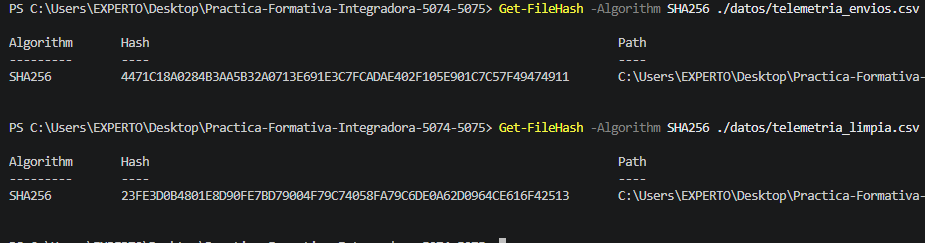
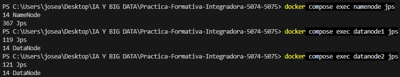
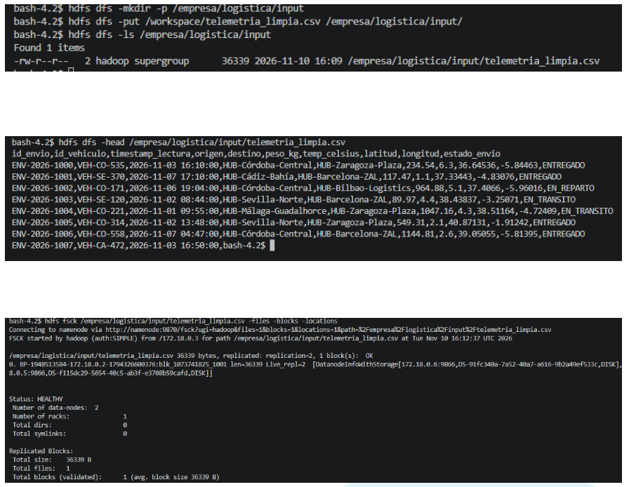
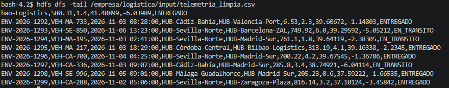
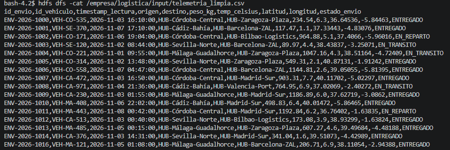
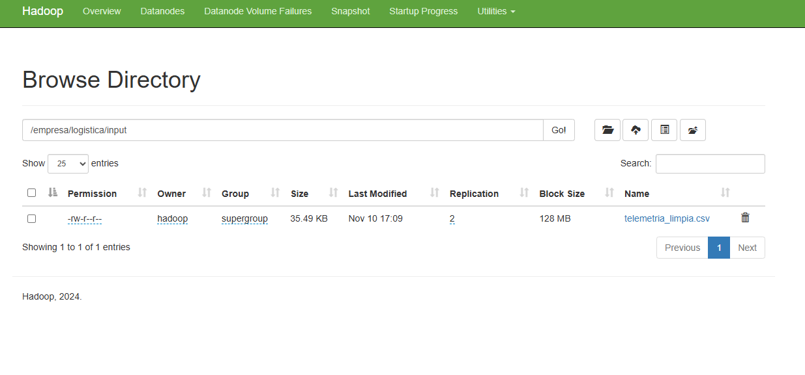

# Práctica Formativa Integradora: integridad de datos y HDFS

Repositorio de la práctica de **Sistemas de Big Data (Módulo 5074)** y **Almacenamiento y Gestión de Datos (Módulo 5075)**.

## Estructura del repositorio

```text
.
├── Dockerfile
├── docker-compose.yml
├── config
├── datos/
│   ├── telemetria_envios.csv
│   └── telemetria_limpia.csv
├── scripts/
│   └── limpiar_telemetria.py
└── evidencias/
    ├── 01_hashes_sha256.png
    ├── 02_jps_servicios.png
    ├── 03_hdfs_comandos_fsck.png
    └── 04_webui_hdfs_browse.png
```

## 1. Integridad del dataset (Módulo 5075)

Se calculó SHA-256 sobre los bytes de cada CSV. El original se conserva y el script `scripts/limpiar_telemetria.py` genera `datos/telemetria_limpia.csv`, eliminando filas duplicadas, registros con valores nulos en los campos críticos, pesos no positivos, temperaturas superiores a 50 °C y estados de envío no reconocidos.

| Archivo | Momento | SHA-256 |
|---|---|---|
| `datos/telemetria_envios.csv` | Original, antes de depurar | `4471C18A0284B3AA5B32A0713E691E3C7FCADAE402F105E901C7C57F49474911` |
| `datos/telemetria_limpia.csv` | Resultado, después de depurar | `23FE3D0B4801E8D90FE7BD79004F79C74058FA79C6DE0A62D0964CE616F42513` |

Para repetir la limpieza y obtener ambos hashes:

```bash
python -m pip install pandas
python scripts/limpiar_telemetria.py
```

La firma SHA-256 cambia porque el CSV depurado contiene bytes distintos del original. La captura del cálculo está en [01_hashes_sha256.png](evidencias/01_hashes_sha256.png).

## 2. Despliegue y exploración HDFS (Módulo 5074)

El entorno se construye con Docker Compose. El Dockerfile añade un JDK 8 porque la imagen base de Hadoop incluye Java de ejecución, pero no la herramienta de diagnóstico `jps`. Compose inicia NameNode, dos DataNodes, ResourceManager y NodeManager. Los puertos publicados en el equipo anfitrión son **9870** (Web UI del NameNode) y **8088** (Web UI de YARN); el puerto RPC de HDFS, **8020**, se usa en la red interna de Compose.

```bash
docker compose up -d --build
docker compose ps
```

Cada daemon se ejecuta en un contenedor distinto. Para comprobar el NameNode y los DataNodes con `jps`:

```bash
docker compose exec namenode jps
docker compose exec datanode1 jps
docker compose exec datanode2 jps
docker compose exec resourcemanager jps
docker compose exec nodemanager jps
```

En cada salida aparece el proceso Hadoop correspondiente y el proceso temporal `Jps`. La evidencia solicitada está en [02_jps_servicios.png](evidencias/02_jps_servicios.png).

El directorio local `datos/` se monta como `/workspace` en el NameNode. Estos comandos cargan el CSV depurado, lo listan y revisan sus bloques y ubicaciones:

```bash
docker compose exec namenode hdfs dfs -mkdir -p /empresa/logistica/input
docker compose exec namenode hdfs dfs -put /workspace/telemetria_limpia.csv /empresa/logistica/input/
docker compose exec namenode hdfs dfs -ls /empresa/logistica/input/
docker compose exec namenode hdfs fsck /empresa/logistica/input/telemetria_limpia.csv -files -blocks -locations
docker compose exec namenode hdfs dfs -cat /empresa/logistica/input/telemetria_limpia.csv
docker compose exec namenode hdfs dfs -head /empresa/logistica/input/telemetria_limpia.csv
docker compose exec namenode hdfs dfs -tail /empresa/logistica/input/telemetria_limpia.csv
```

La configuración de esta práctica establece un factor de replicación de **2**. La evidencia de `put`, `ls` y `fsck` está en [03_hdfs_comandos_fsck.png](evidencias/03_hdfs_comandos_fsck.png). La Web UI del NameNode está disponible en [http://localhost:9870](http://localhost:9870); desde **Utilities → Browse the file system** se puede localizar `/empresa/logistica/input/telemetria_limpia.csv`. Captura: [04_webui_hdfs_browse.png](evidencias/04_webui_hdfs_browse.png).

## 3. Análisis crítico: tolerancia a fallos en HDFS

HDFS divide los archivos en bloques y guarda varias copias de cada uno en diferentes DataNodes. De esta forma, si uno de los nodos deja de funcionar, los datos no se pierden, ya que se puede acceder a otra copia almacenada en otro nodo. El NameNode detecta estos fallos porque deja de recibir señales (heartbeats) del DataNode y, si es necesario, ordena crear nuevas copias para mantener la información protegida.

Además, HDFS utiliza un sistema de comprobación llamado checksums, que permite detectar si algún bloque está dañado. Si esto ocurre, puede utilizar otra copia que esté en buen estado. Esto hace que el sistema sea más seguro, aunque depende de que siga existiendo al menos una copia válida. También hay que tener en cuenta que tener varias copias no sustituye a realizar copias de seguridad.

En nuestra práctica tenemos dos DataNodes y hemos configurado el factor de replicación en 2. Esto significa que cada bloque tiene dos copias. Si uno de los DataNodes falla, todavía podemos acceder a los datos desde el otro, aunque no se podrán recuperar las dos copias hasta que haya otro nodo disponible. En un entorno real, se suelen utilizar más nodos y distribuirlos en diferentes equipos para reducir el riesgo de perder información.

## 4. Evidencias gráficas

### 01. Hashes SHA-256 antes y después de la depuración



### 02. Procesos Hadoop con `jps`



### 03. Carga y revisión de bloques HDFS





### 04. Explorador HDFS de la Web UI


